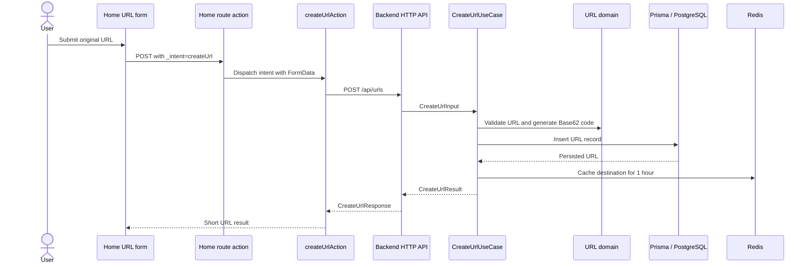
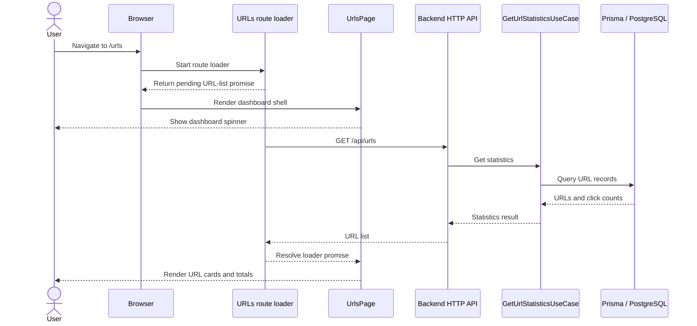
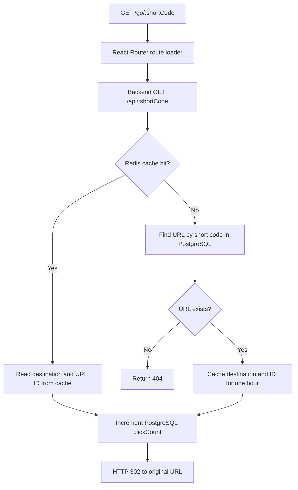
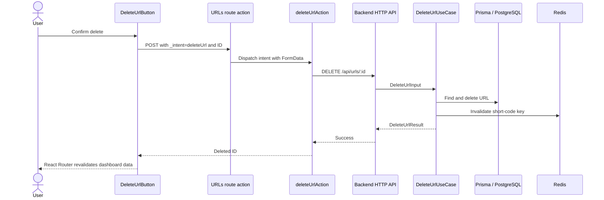

# Application Flows

These diagrams show how requests cross the frontend, API, application, domain, and infrastructure boundaries.

## Create a short URL

## Load the dashboard

## Redirect and track a click

## Delete a short URL

